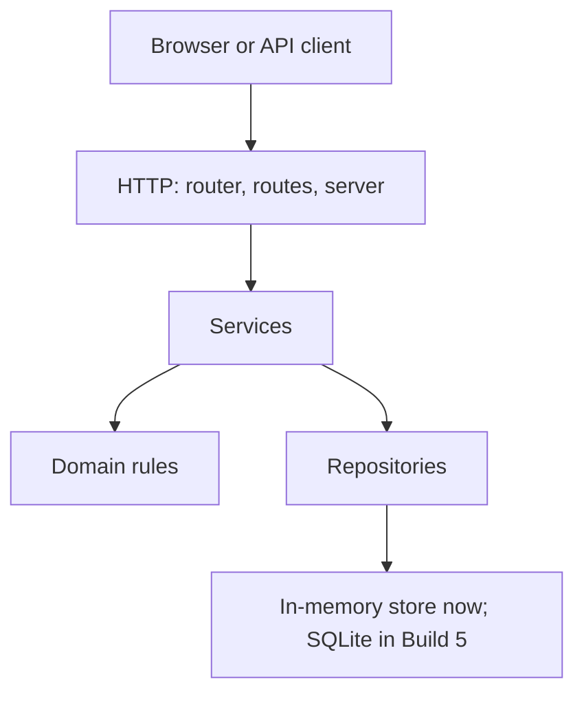
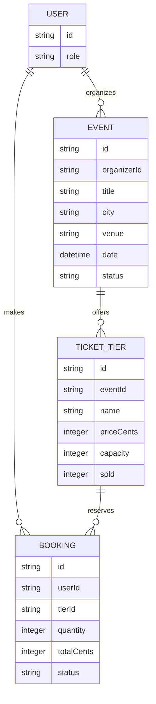
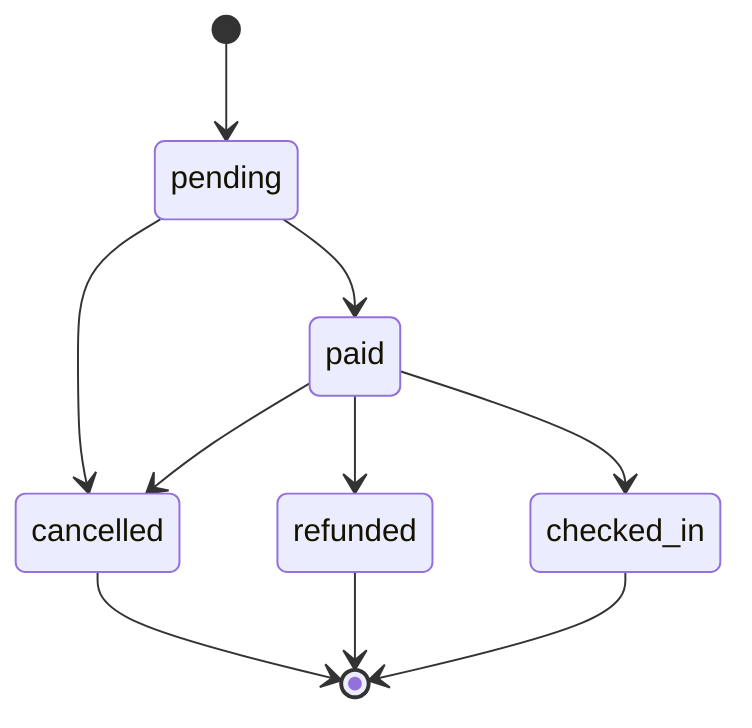

# Build 3 Architecture and Booking States

## Layers

- **HTTP** translates requests and responses; it may call services and must not contain business rules or access storage directly.
- **Services** coordinate use cases; they may call domain rules and repositories, but must not depend on HTTP request/response details.
- **Domain** contains plain business rules and state transitions; it must not perform I/O or depend on HTTP, services, or repositories.
- **Repositories** read and write data; they must not decide business policy or call services/routes.

Arrows show allowed dependencies only; no layer calls upward.

## Data model

## Booking life cycle

`cancelled`, `refunded`, and `checked_in` are final states. The domain state machine in `src/domain/bookingStateMachine.js` defines and validates these transitions.
